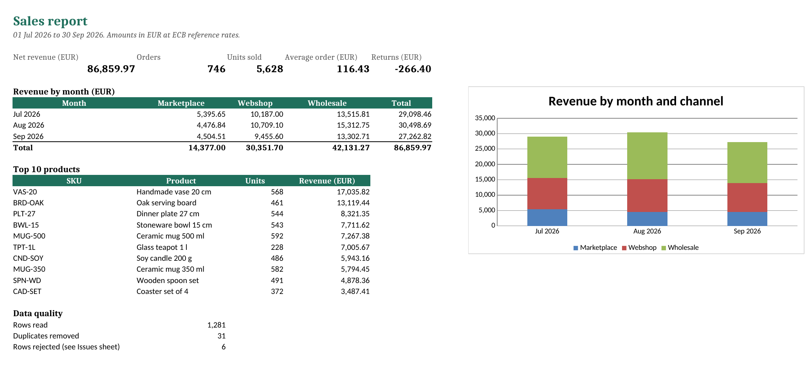
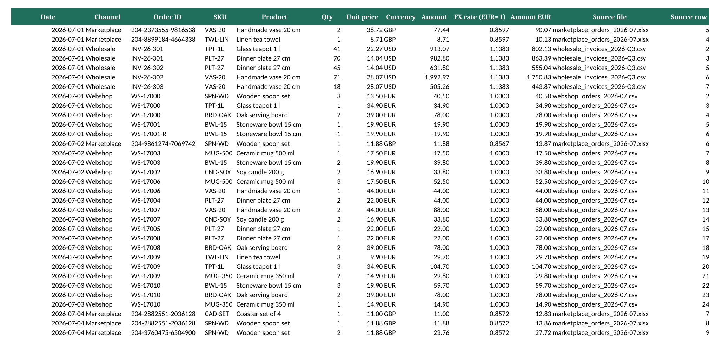

# Sales report automation

A Python script that replaces a weekly copy-paste job: it reads sales exports from three different channels, cleans them, converts every amount to one currency at the official ECB rate of that day, and writes a formatted Excel report.



**Example output:** [`examples/sales_report_2026-Q3.xlsx`](examples/sales_report_2026-Q3.xlsx), built from the fictional exports in [`data/sample`](data/sample).

## What it handles

The three sample sources look like real exports, problems included:

| Source | Format | Currency | Quirks |
| --- | --- | --- | --- |
| Webshop | monthly CSV | EUR | timestamps, refunds as negative quantities, lowercase SKUs with spaces |
| Marketplace | monthly `.xlsx` | GBP | two title rows above the header, `dd/mm/yyyy` text dates, each export repeats the last 3 days of the previous month |
| Wholesale | one CSV, `;` separated | USD | `dd.mm.yyyy` dates, decimal comma (`14,04`), stray blank line |

What the script does with them:

- **Maps columns** from each format to one schema, configured in [`sources.toml`](sources.toml). A new channel is a new block there, not new code.
- **Validates every row**: invalid dates (`31/09/2026`), missing prices, zero quantities and missing order IDs are rejected with a reason instead of silently dropped.
- **Removes duplicates** from overlapping exports, and records which file and row each duplicate repeats.
- **Converts currencies** with [European Central Bank reference rates](https://www.ecb.europa.eu/stats/policy_and_exchange_rates/euro_reference_exchange_rates/html/index.en.html) (via the free [Frankfurter API](https://frankfurter.dev)), using the rate of the order date and the last published rate on weekends. Rates are cached, so re-runs and offline runs give the same numbers.
- **Writes the report** with three sheets:
  - **Summary**: net revenue, orders, units, average order, returns; revenue by month and channel with a chart; top 10 products; data quality counts
  - **Orders**: every clean line with its original amount, the FX rate used, the converted amount and the source file and row, so any number can be traced back
  - **Issues**: every rejected or duplicate row, with file, row number and reason



```text
$ uv run salesreport --input data/sample --output examples/sales_report_2026-Q3.xlsx
INFO    Webshop: 239 rows from webshop_orders_2026-07.csv
...
INFO    FX: downloading ECB rates EUR->GBP,USD for 2026-06-24..2026-09-30
INFO    1,281 rows read, 31 duplicates removed, 6 rows rejected
INFO    Net revenue (EUR)      86,859.97
INFO    Orders                 746
INFO    Units sold             5,628
INFO    Average order (EUR)    116.43
INFO    Returns (EUR)          -266.40
INFO    report written to examples/sales_report_2026-Q3.xlsx
```

## Run it

Requires Python 3.12+ and [uv](https://docs.astral.sh/uv/).

```bash
uv sync
uv run salesreport --input data/sample                      # writes out/sales_report.xlsx
uv run salesreport --input data/sample --offline \
    --rates-cache examples/fx_rates.json                    # no network, cached rates
uv run python scripts/make_sample_data.py                   # regenerate the sample exports
```

Options: `--config` (default `sources.toml`), `--output`, `--rates-cache`, `--offline`, `-v`. The exit code is 1 with a clear message when an input folder, a column or an exchange rate is missing.

## Tests

```bash
uv run pytest
```

27 tests, no network needed (rates come from a fake fetcher). Besides unit tests for number formats, dates, validation, duplicates and FX, the end-to-end tests check that the report reconciles:

- rows read = valid lines + duplicates + rejected rows
- the Summary total equals the sum of the Orders sheet and the monthly table total
- every converted amount equals the original amount divided by the rate shown next to it
- row numbers in the Issues sheet point at the right line of the source file

## Project layout

```text
src/salesreport/
  load.py      config + reading CSV/Excel into one schema
  clean.py     parsing, validation, duplicates
  fx.py        ECB rates, cache, conversion
  report.py    Excel output (openpyxl)
  pipeline.py  the steps in order
  cli.py       command line
scripts/make_sample_data.py   fictional sample exports
```

All data in this repository is fictional.
